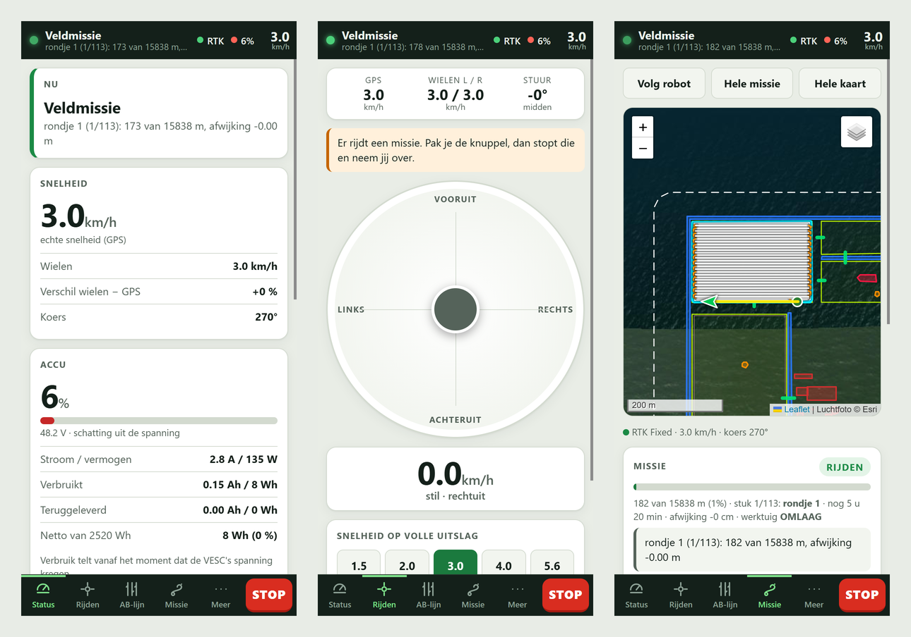
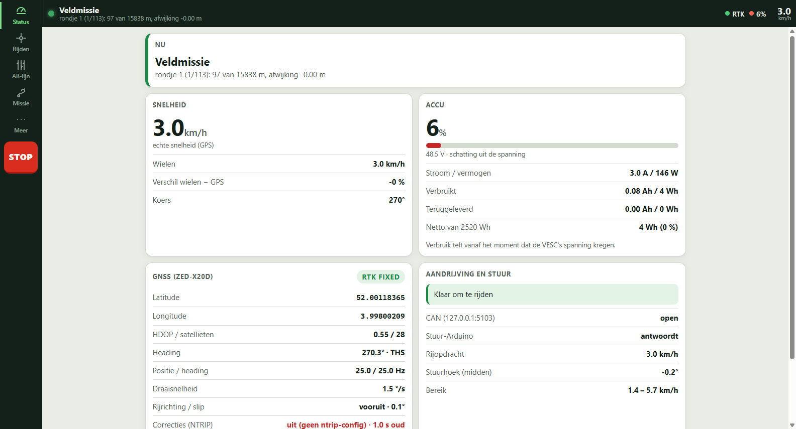
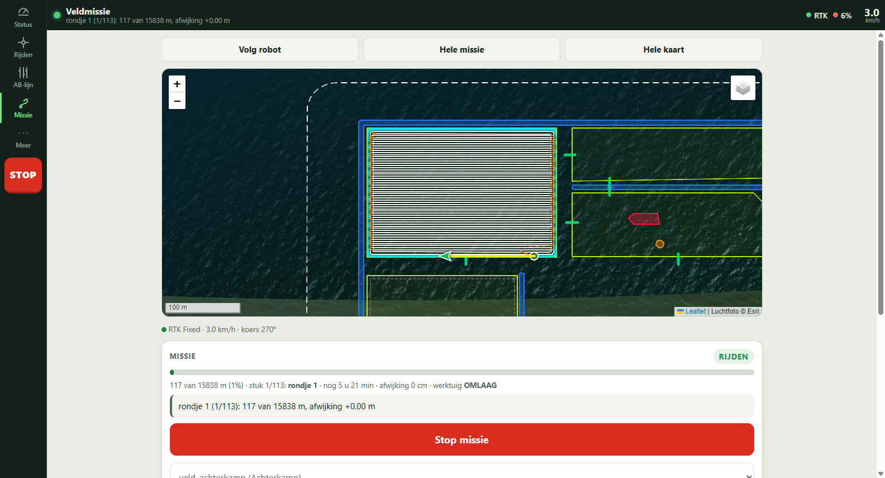
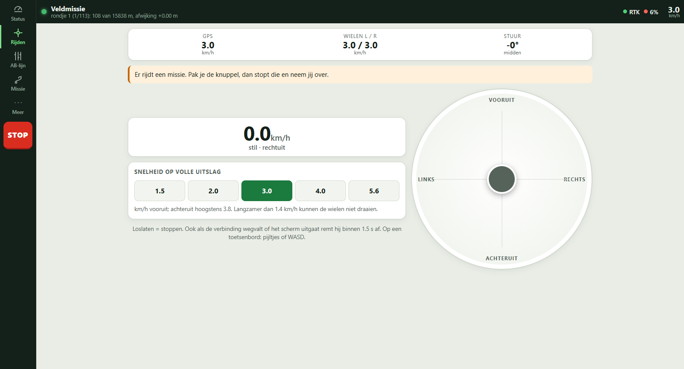
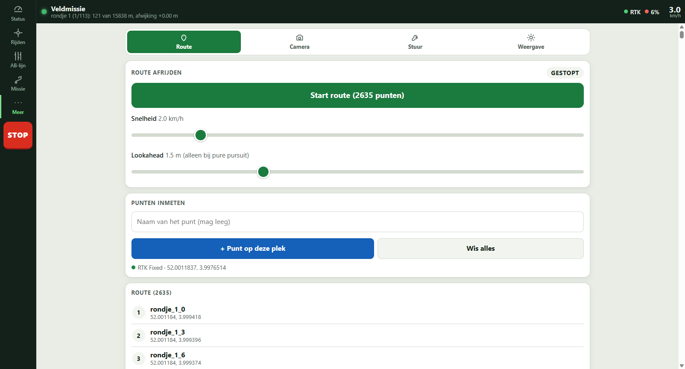
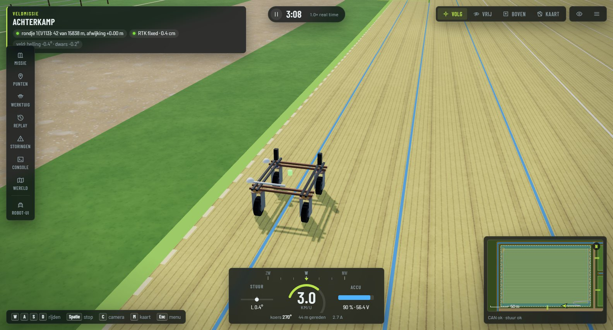

# Bruut OpenAgbot

An open-source, RTK-guided field robot built on a farm, for a farm: mowing, dock-weed drilling, liquid manure
injection and scouting, driven autonomously along AB lines and whole-field missions.

<p align="left">
  <a href="https://www.youtube.com/@opensource_agbot/videos"></a>
  <a href="https://jacobsfarm.github.io/Bruut_openagbot_website/"></a>
  <a href="https://github.com/JacobsFarm/Bruut_OpenAgbot_Implements"></a>
  <a href="https://github.com/JacobsFarm/openagbot-fieldsim"></a>
  <a href="LICENSE"></a>
</p>


> [!WARNING]
> Experimental prototype. Read the [disclaimer](#disclaimer) before you build or run one.

## Contents

- [What it is](#what-it-is)
- [Web interface](#web-interface)
- [Quick start](#quick-start)
- [Missions](#missions)
- [Simulator](#simulator)
- [Hardware and CAD](#hardware-and-cad)
- [Repository layout](#repository-layout)
- [Disclaimer](#disclaimer)

## What it is

| Part | What |
| --- | --- |
| Positioning | One u-blox ZED-X20D (simpleRTK4 Dual): RTK position, dual-antenna heading (THS) and speed at 25 Hz |
| Steering | Two steered front wheels with NEMA34 steppers, Ackermann angles, driven by an Arduino over serial |
| Drive | Two rear hub motors on two VESCs over CAN, with an exact electronic differential in corners |
| Computer | NVIDIA Jetson running the Python backend (FastAPI) and the Svelte web interface |
| Navigation | Stanley controller on AB lines with headland turns, mission follower for whole-field missions, pure pursuit for waypoint routes |
| Safety | Physical e-stop, dead-man switch on manual driving and on the navigators, geofence that stops the robot at ditches and no-go zones, ride logs of every run |
| Vision (optional) | YOLO models (Ultralytics / TensorRT) for detecting weeds, diseases and bird nests |

The current prototype runs on Python, C++ (Arduino) and Svelte. A move to ROS 2 and Foxglove is planned.

## Web interface

The robot hosts its own web app on port 8000. It is made for a phone in the field: big buttons, a STOP button on
every tab, and warnings about drive or steering problems stay in view whatever tab you are on. On a wide screen
the tabs move to a rail on the left.

<p align="center">
  
</p>

| Tab | What you do there |
| --- | --- |
| **Status** | Speed (GPS and wheels), battery and consumption, GNSS fix and heading, CAN and steering health |
| **Rijden** | Drive by hand with a virtual joystick (or arrow keys / WASD). Release = stop: it brakes within 1.5 s if the connection drops |
| **AB-lijn** | Pick a field and start an AB-line mission; live map with planned, current and driven swaths and headland turns |
| **Missie** | Run a whole-field mission from the simulator's planner: progress, deviation, implement up/down, stop and resume |
| **Meer** | Record and drive waypoint routes, camera, steering calibration, display settings |

<table>
  <tr>
    <td width="50%"></td>
    <td width="50%"></td>
  </tr>
  <tr>
    <td align="center"><sub><b>Status</b>: every sensor and actuator on one page</sub></td>
    <td align="center"><sub><b>Missie</b>: a field mission being driven, with the geofence around the ditches</sub></td>
  </tr>
  <tr>
    <td width="50%"></td>
    <td width="50%"></td>
  </tr>
  <tr>
    <td align="center"><sub><b>Rijden</b>: manual driving with a dead-man joystick</sub></td>
    <td align="center"><sub><b>Meer</b>: record points and drive waypoint routes</sub></td>
  </tr>
</table>

<sub>Screenshots taken with the robot software running inside the simulator (fantasy example farm), so the
values are simulated.</sub>

## Quick start

On the robot (Jetson, Linux) or on any PC for development:

```bash
pip install -r requirements.txt
cp data/config.example.json data/config.json   # then set ports, vehicle sizes, steering and battery
python run.py
```

Open `http://localhost:8000` on the robot, or `http://<robot-ip>:8000` from a phone on the same WiFi or hotspot.
`AGBOT_CONFIG=path/to/config.json` selects another config file; the simulator uses this to point the robot at
`data/config.sim.json`.

The built web interface (`frontend/dist`) is committed, so you only need Node to change the interface:

```bash
cd frontend
npm install
npm run build
```

Notes on the Jetson, CAN bus and serial ports are in [setup/information](setup/information), the VESC setup and
wiring in [VESC](VESC/README.md).

## Missions

### AB lines

You measure two points with the RTK: **A = the bottom-left corner** of the field and **B = the top-left corner**.
Together they set the direction and the length of the swaths. Build the mission with one script:

```bash
python Single_script_code/AB_mission_maker.py
```

Set the field name, the two points, the work width and the number of swaths at the top of the script. It writes
the mission into `data/ab_line.json` and draws a preview: `ab_missie.jpg` (field sketch in metres),
`ab_missie_gps.jpg` (same mission in lat/lon) and `ab_missie.html` (interactive satellite map), so you can check
the headlands before driving.

The script plans a **skip pass** order: on the way out it skips a swath every time (0, 2, 4, 6) and on the way
back it fills the gaps (7, 5, 3, 1). The side step at almost every headland turn is then twice the work width,
which is exactly what a four-wheeler needs: a half circle of twice the minimum turning radius fits. Only at the
turning point of the pattern (6 -> 7) do two swaths sit next to each other; there the robot drives an omega turn.

At the end of a swath the robot keeps going straight for `kopakker_extra_m` (2 m by default) into the headland
before it turns. The turn ends at exactly the same distance along the line as where it started, so after the turn
the robot has the same 2 m of straight run-in to settle on the new line before the crop begins.

Pick the field in the web interface under **AB-lijn** and press start.


### Whole-field missions and geofence

The simulator plans a complete field: headland rounds along the edge, straight swaths through the middle, turns
the robot can actually drive, and a per-edge clearance for ditches, roads, fences and buildings. It sends three
files to the robot: `kaart.json` (the no-go map, **always enforced**, also when driving by hand),
`veldmissie.json` (the route) and `waypoints.json`. How it works and what is still missing:
[docs/veldmissie.md](docs/veldmissie.md).

### Ride logs

Every run is logged as a CSV in `data/logs/`. `Single_script_code/extract_ride_report.py` turns a log into a ride
report (deviation, speed, steering); the simulator can replay the logs.

### Task cards from detections

Detections of diseases, bird nests or sprayed weeds can be turned into task cards.


## Simulator

[**OpenAgbot FieldSim**](https://github.com/JacobsFarm/openagbot-fieldsim) runs this exact software
(software-in-the-loop) in a 3D farm. It emulates the GNSS receiver, the steering Arduino and both VESCs on their
own protocols, so everything above the drivers (navigators, safety, logger, web interface) runs unchanged. Use it
to plan field missions, test failures (lost RTK fix, stuck stepper, CAN down) and replay ride logs before you go
out to the field.



## Hardware and CAD

The newest configuration is the 2WD with two steered front wheels and two driven rear hub motors.


The designs live in [CAD_designs](CAD_designs) (OpenSCAD assemblies, and script-generated FreeCAD models in
`CAD_designs/freecad`). They were reworked after field testing: stronger, more realistic and with room for
extensions. Implements (mower bar, dock-weed drill, liquid manure injector) are in the
[implements repo](https://github.com/JacobsFarm/Bruut_OpenAgbot_Implements).

<p>


</p>

<details>
<summary><b>4WD designs</b>: four electric hub motors</summary>


</details>

<details>
<summary><b>2WD designs</b>: two caster wheels at the back</summary>


</details>

## Repository layout

| Path | What |
| --- | --- |
| `run.py` | Starts the backend and web interface on port 8000 |
| `app/api/` | HTTP API (FastAPI) used by the web interface and the simulator |
| `app/hardware/` | Drivers: GNSS (`gps_logic.py`), steering Arduino (`stepper_logic.py`), VESCs over CAN (`vesc_can.py`) |
| `app/services/` | Navigation (AB line, mission follower, waypoints), vehicle controller, geofence, ride logger |
| `app/vision/` | Camera and YOLO detection |
| `frontend/` | Svelte web interface; `frontend/dist` is the committed build |
| `data/` | `config.example.json`, `config.sim.json`, examples for AB lines and waypoints; your own config, missions and logs stay local |
| `Arduino/` | Firmware for the dual stepper steering controller |
| `VESC/` | VESC configuration, CAN notes and wiring |
| `Single_script_code/` | Stand-alone tools: AB mission maker, RTK point logger, ride report, TensorRT conversion |
| `CAD_designs/` | OpenSCAD and FreeCAD models of the robot |
| `setup/` | Jetson, CAN and camera setup notes, hardware specs |
| `docs/` | Design notes (field missions and geofence) and README images |
| `weights/` | Place for detection model weights (see `NOTES.txt`) |

## Disclaimer

> [!WARNING]
> **Use at your own risk**
> - This is an experimental prototype under active development, not a finished or certified product.
> - All software and designs are open source (AGPL-3.0) and provided **"as is"**, without warranty of any kind. The makers and contributors are not liable for any damage, injury or loss resulting from their use (see sections 15 and 16 of the license).
> - Autonomous machines can behave unexpectedly, for example by driving into a ditch or water. Always supervise the robot, test at low speed, use a physical emergency stop, an RC failsafe and a geofence, and keep people and animals at a safe distance.
> - You are responsible for complying with local laws and safety regulations. Do not use the robot on public roads.

## License

[AGPL-3.0](LICENSE)
